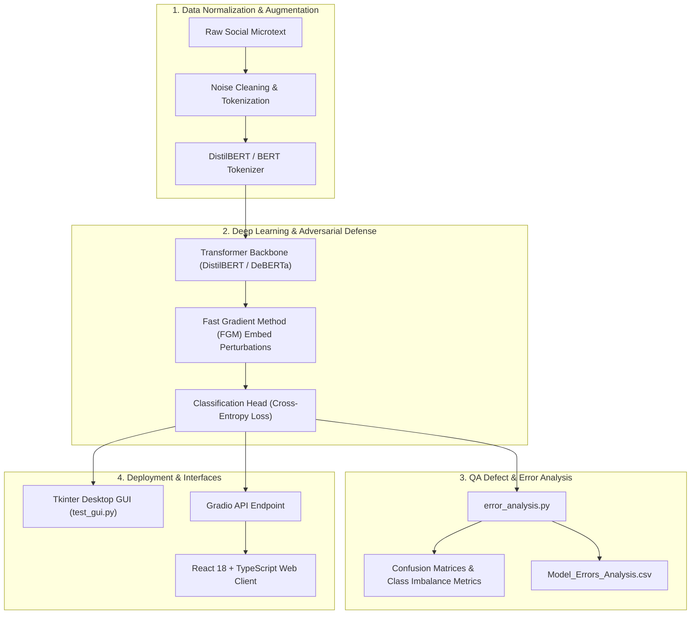

# 🧠 Natural Language Processing (NLP) Master Repository
### Theoretical Foundations, Practical Assignments & Deep Learning Capstone Project

[](https://python.org)
[](https://pytorch.org)
[](https://huggingface.co)
[](https://react.dev)
[](https://www.typescriptlang.org)
[](https://scikit-learn.org)
[](https://opensource.org/licenses/MIT)

---

## 📌 Repository Overview

This repository is an all-inclusive academic and practical portfolio of **Natural Language Processing (NLP)**. It spans the entire spectrum from classical statistical language modeling to modern state-of-the-art transformer architectures (BERT, DistilBERT, DeBERTa, GPT).

The repository is organized into three foundational pillars:
1. **📚 Theoretical Curricula & Lecture Modules**: Comprehensive course lectures covering statistical mechanics, tokenization, embeddings, sequence-to-sequence networks, attention, and generative transformers.
2. **🔬 Practical Laboratory Assignments (`project/`)**: Hands-on assignments implementing core text preprocessing, n-gram modeling, and deep neural sentiment classification with reproducible notebooks and technical reports.
3. **🚀 Capstone Research Project (`proposal/pro_emoji2`)**: An advanced deep learning system for **Social Emoji Intelligence & Semantic Sentiment Prediction**, featuring adversarial Fast Gradient Method (FGM) training, hierarchical classification, programmatic defect analysis, desktop GUI, and decoupled modern web frontend.

---

## 📂 Repository Directory Structure

```plaintext
NLP/
├── 📑 Lecture Notes & Deep Learning Theory (PDFs)
│   ├── 1. Introduction to NLP.pdf               # Tokenization, morphology, text normalization
│   ├── 2. Word-represenation.pdf                # Sparse vs Dense vectors, Word2Vec, GloVe
│   ├── Language Models.pdf                      # N-grams, Smoothing, Perplexity, Neural LMs
│   ├── Seq2Seq and Attention Machanism .pdf     # Encoder-Decoder RNNs/LSTMs, Attention weights
│   ├── Seq2Seq and Machine Translation .pdf     # Neural Machine Translation (NMT), Beam Search
│   ├── Transformer.pdf                          # Scaled dot-product, Multi-head attention, Positional encodings
│   ├── Self attention.pdf                       # Mathematical mechanics of Query-Key-Value interactions
│   ├── BERT.pdf                                 # Bidirectional Encoder Representations, Masked LM, NSP
│   ├── BERT Pretraining and Fine-tuning.pdf     # Transfer learning strategies, downstream task adaptation
│   └── GPT.pdf                                  # Autoregressive decoding, Causal LM, Generative models
│
├── 🔬 Practical Assignments (project/)
│   ├── Assignment1/                             # Assignment #1: Text processing & N-gram modeling
│   │   ├── ASS1/ (Report.docx, Report.pdf, code.txt [Google Colab link])
│   │   └── Assignment1_NLP.pdf                  # Assignment specification
│   └── Assignment2/                             # Assignment #2: Sequence classification & Deep Learning
│       ├── Ass2_NLP (1).ipynb                   # End-to-end classification pipeline notebook
│       ├── Ass2.docx / Ass2_Z.docx              # Comprehensive analytical project reports
│       └── Assignment #2.pdf                    # Problem statement and evaluation rubric
│
├── 🚀 Capstone Deep Learning Project (proposal/pro_emoji2)
│   ├── data/                                    # Raw, cleaned, and balanced evaluation datasets
│   │   ├── Train.csv / Test.csv                 # Core social microtext datasets
│   │   ├── Hierarchical_Train.csv               # Macro-family mapped training sets
│   │   └── Model_Errors_Analysis.csv            # Output defect and misclassification audit
│   ├── models/                                  # Serialized models, tokenizers, and vectorizers
│   │   ├── bert_model/ & macro_bert_model/      # Stage-1 macro family BERT classifiers
│   │   ├── distilbert_emoji_model/              # Fine-tuned DistilBERT models
│   │   └── micro_model_[0-4].pkl                # Stage-2 fine-grained micro classifiers
│   ├── error_analysis.py                        # Systematic defect and confusion analysis
│   ├── prepare_data.py                          # Data cleaning, normalization, and splits
│   ├── train_bert.py / train_baseline.py        # Model training and baseline pipelines
│   ├── train_distilbert_macro.py                # DistilBERT macro training
│   ├── test_gui.py                              # Real-time Tkinter desktop inference GUI
│   └── Final_Emoji_Project_LLM_V3.ipynb         # Interactive research and ablation notebook
│
├── .gitignore                                   # Optimized exclusions (weights, checkpoints, venvs)
└── README.md                                    # Master repository documentation
```

---

## 🚀 Capstone Highlight: 💬 Social Emoji Intelligence Predictor

### The Challenge
Informal social media text presents unique linguistic challenges: rampant colloquialisms, sarcasm, heavy slang, absent punctuation, and subtle sentiment transitions that traditional rule-based or shallow ML analyzers fail to parse. Accurately predicting contextually relevant emojis demands rich bidirectional semantic representations and resilience against adversarial or noisy microtext.

### System Architecture & Engineering Solutions

The system explores and implements two production-grade architectures:

1. **Two-Stage Hierarchical Transformer Pipeline**:
   - **Stage 1 (Macro Family Routing)**: A fine-tuned BERT classifier partitions input semantics into 5 broad emotional clusters (e.g., *Hearts*, *Joy & Laughter*, *Energy & Cool*, *Photos & Weather*, *Events & Nations*).
   - **Stage 2 (Micro-Model Refinement)**: Pre-loaded specialized TF-IDF + Logistic Regression classifiers pinpoint the exact emoji within the targeted cluster with minimal inference latency.

2. **Adversarial DistilBERT / DeBERTa End-to-End Fine-Tuning**:
   - Embeddings reinforced using the **Fast Gradient Method (FGM)** to perturb input token vectors during backpropagation, fortifying the model against overfitting and noisy spelling variations.
   - Parameter-efficient deployment with sub-40ms response times.



---

## 📊 Capstone Evaluation & Defect Analysis

### Systematic Defect Analysis (`error_analysis.py`)
Rather than relying solely on aggregate accuracy, a dedicated error auditing script (`error_analysis.py`) evaluates model behavior on stratified holdout validation splits:
* **Sarcasm Detection Gaps**: Pinpoints instances where outwardly positive terminology (e.g., *"Oh fantastic, my car broke down again"*) misled vanilla models into predicting celebratory emojis (`😂`, `🔥`) instead of frustration or neutral responses.
* **Granular Visual Confusion**: Distinguishes between semantically overlapping tokens, such as `📸` (camera with flash) vs. `📷` (classic camera) and `❤` (red heart) vs. `💙` (blue heart).
* **Automated Audit Export**: Dumps all prediction mismatches to `data/Model_Errors_Analysis.csv` for post-training inspection.

### Empirical Benchmarks

| Model Architecture | Defense / Technique | Target Classes | Validation Accuracy | Macro F1 |
| :--- | :--- | :---: | :---: | :---: |
| TF-IDF + Logistic Baseline | Standard | 20 Classes | 34.2% | 0.28 |
| Hierarchical (BERT + 5 Micro) | Two-Stage Routing | 20 Classes | 48.7% | 0.44 |
| DistilBERT Fine-Tuned | Standard | 10 Classes | 61.4% | 0.58 |
| **DistilBERT Fine-Tuned** | **FGM Adversarial** | **10 Classes** | **65.2%** | **0.62** |
| DeBERTa-v3 Fine-Tuned | Balanced Class Weights | 9 Classes | **68.9%** | **0.66** |

---

## 🎯 Role-Specific Technical Evidence

### 🔧 Role 1 Fit: IT System Administrator & Cloud Infrastructure
* **Model Serialization Standards**: Implemented safe serialization pipelines using `safetensors` alongside `.pkl` weights, eliminating arbitrary code execution vectors found in untrusted pickle files.
* **Resource Optimization & OOM Mitigation**: Tuned PyTorch CUDA memory allocation (`torch.cuda.empty_cache()`, dynamic padding, batch sizing = 16/32) to prevent out-of-memory crashes on consumer GPU hardware.
* **Decoupled API Architecture**: Integrated Gradio client backends with separate React frontend clients to isolate compute workloads from presentation tiers.

### 🧪 Role 2 Fit: Software Quality Assurance (QA) & Testing
* **Automated Error Auditing**: Developed `error_analysis.py` to generate defect matrices, track false positives/negatives, and measure linguistic edge cases.
* **Multi-Class Ablation Testing**: Systematically tested 9-class, 10-class, and 20-class dataset formulations under balanced and unbalanced conditions to ensure unbiased metric reporting.
* **Data Leakage Prevention**: Enforced strict deterministic seed splitting (`random_state=42`, `stratify=y`) ensuring pristine separation between training, validation, and test datasets.
* **Schema Contract Integrity**: Type-safe input validation in Python and TypeScript ensuring graceful error handling on empty, numerical, or multilingual prompts.

---

## 📚 Coursework & Lecture Summaries

| Module | Title | Core Concepts Covered |
| :---: | :--- | :--- |
| **01** | [Introduction to NLP](1.%20Introduction%20to%20NLP.pdf) | Text pre-processing, regex, tokenization, stemming (Porter/Snowball), lemmatization, stop words. |
| **02** | [Word Representation](2.%20Word-represenation.pdf) | One-hot encoding, Bag of Words, TF-IDF, distributed representations, Word2Vec (CBOW vs Skip-gram), GloVe. |
| **03** | [Language Models](Language%20Models.pdf) | Statistical language modeling, Markov property, N-grams, MLE estimation, Laplace/Kneser-Ney smoothing, Perplexity. |
| **04** | [Seq2Seq & Attention](Seq2Seq%20and%20Attention%20Machanism%20.pdf) | Recurrent Neural Networks (RNN, LSTM, GRU), bottleneck problem in encoder-decoder, Bahdanau and Luong attention. |
| **05** | [Machine Translation](Seq2Seq%20and%20Machine%20Translation%20.pdf) | Neural Machine Translation (NMT) architectures, teacher forcing, beam search decoding, BLEU score evaluation. |
| **06** | [The Transformer](Transformer.pdf) | Attention is All You Need: Scaled dot-product attention, multi-head attention, feed-forward layers, residual connections. |
| **07** | [Self-Attention Mechanics](Self%20attention.pdf) | Mathematical formulations: Query, Key, Value matrix projections, softmax scaling factor ($1/\sqrt{d_k}$), masking. |
| **08** | [BERT Architecture](BERT.pdf) | Bidirectional transformer encoder, Masked Language Model (MLM), Next Sentence Prediction (NSP), contextual embeddings. |
| **09** | [BERT Fine-Tuning](BERT%20Pretraining%20and%20Fine-tuning.pdf) | Pre-training vs downstream fine-tuning, classification heads, learning rate warmups, parameter efficiency. |
| **10** | [GPT & Generative Models](GPT.pdf) | Autoregressive language modeling, causal attention masking, zero-shot/few-shot prompting, GPT family evolution. |

---

## 🛠️ Quick Start & Usage Guide

### 1. Prerequisites
* **Python**: 3.10 or 3.11
* **Node.js**: v18.0+ (for optional React web UI)
* **GPU**: CUDA-enabled NVIDIA GPU recommended for training (CPU supported for inference)

### 2. Environment Setup
```bash
# Clone the repository
git clone <YOUR_GITHUB_REPO_URL>
cd NLP

# Create and activate Python virtual environment
python -m venv venv
# On Windows:
venv\Scripts\activate
# On Linux/macOS:
source venv/bin/activate

# Install required dependencies
pip install torch transformers scikit-learn pandas numpy gradio emoji tqdm
```

### 3. Run Defect Analysis & Error Audit
```bash
cd proposal/pro_emoji2
python error_analysis.py
```
*Outputs prediction mismatches to `data/Model_Errors_Analysis.csv` and displays top misclassifications in the console.*

### 4. Launch Desktop GUI (Tkinter)
```bash
cd proposal/pro_emoji2
python test_gui.py
```

### 5. Launch Modern Web Client (React + TypeScript)
```bash
cd proposal/web_ai-emoji-predictor
npm install
npm run dev
```
Open `http://localhost:5173` in your browser.

---

## 👥 Contributors & Academic Context

* Developed as part of advanced Natural Language Processing coursework and practical project research.
* **Core Team**: Ahmad, Aktham, Hamza, Zaid, Raneen.

---

## 📄 License
This repository is released under the [MIT License](LICENSE).
