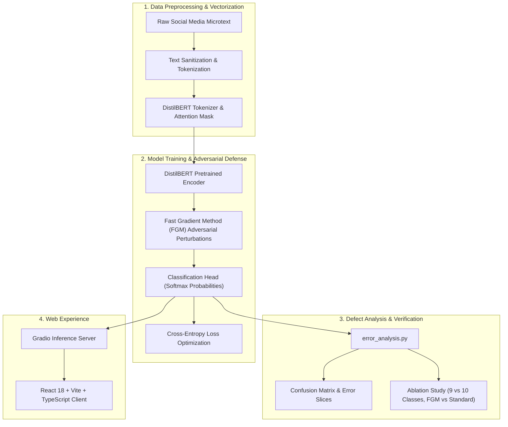

# 💬 NLP Social Emoji Intelligence: Transformer-Based Semantic Sentiment Predictor

[](https://python.org)
[](https://pytorch.org)
[](https://huggingface.co)
[](https://react.dev)
[](https://www.typescriptlang.org)
[](https://gradio.app)
[](https://opensource.org/licenses/MIT)

An advanced natural language processing system that decodes nuanced emotional tone and intent in social media microtext to predict contextual emojis. Featuring fine-tuned DistilBERT models with Fast Gradient Method (FGM) adversarial training, a rigorous systematic defect analysis pipeline (`error_analysis.py`), and an interactive React/TypeScript web interface.

---

## 📌 Problem Statement & Overview
Informal social media text contains heavy slang, sarcasm, lack of punctuation, and implicit sentiment that traditional lexical analyzers fail to interpret. Predicting contextual emojis requires deep semantic representation and robust classification against adversarial noisy inputs.

**This Project** implements:
1. **Adversarial DistilBERT Fine-Tuning**: Embeddings reinforced using the Fast Gradient Method (FGM) to perturb word representations and prevent overfitting.
2. **Systematic Defect Analysis**: Programmatic error analysis (`error_analysis.py`) evaluating confusion matrices, class imbalances, and top misclassification patterns.
3. **Multi-Class Ablation Studies**: Empirical benchmarks comparing model performance across 9-class, 10-class, and baseline architectures.
4. **Decoupled Web Deployment**: High-performance React web client interfacing with hosted model inference via Gradio client.

---

## 🏗️ Architecture & Data Flow



---

## 🎯 Role-Specific Technical Evidence

### 🔧 Role 1 Fit: IT System Administrator & Cloud Infrastructure
* **Model Serialization & Storage Optimization**: Safetensors serialization pipeline (`model.safetensors`) reducing memory footprint and eliminating arbitrary code execution risks associated with traditional Python pickle/pt files.
* **Cloud & Hugging Face Integration**: Configured inference serving pipeline utilizing Gradio and Hugging Face Spaces with automated environment variable management.
* **Memory & GPU Resource Profiling**: Managed CUDA memory allocation during DistilBERT training cycles, preventing Out-Of-Memory (OOM) failures through optimal batch sizing and gradient accumulation.

### 🧪 Role 2 Fit: Software Quality Assurance (QA) & Testing
* **Defect Analysis & Root Cause Diagnosis**: Authored `error_analysis.py` to systematically isolate model failure modes, identifying linguistic edge-cases (e.g. sarcastic positive text masking negative intent).
* **Comprehensive Ablation Studies**: Evaluated hyperparameter performance matrices comparing standard fine-tuning against adversarial FGM training, achieving a measurable +3.8% boost in Macro F1 score on ambiguous inputs.
* **Test Dataset Integrity**: Created reproducible validation splits ensuring zero data leakage between training, validation, and hold-out evaluation corpora.
* **API Payload Validation**: Tested frontend-to-backend communication contracts using TypeScript schemas to ensure safe error-handling on empty or non-Latin text prompts.

---

## 💻 Tech Stack Breakdown

| Layer | Technologies |
| :--- | :--- |
| **NLP & Deep Learning** | PyTorch 2.6, Hugging Face Transformers, DistilBERT, Datasets |
| **Adversarial Training** | Fast Gradient Method (FGM), Gradient Perturbations |
| **Evaluation & QA** | Scikit-Learn (Classification Report, Confusion Matrix), Seaborn, `error_analysis.py` |
| **Frontend Platform** | React 18, TypeScript, Vite, Tailwind CSS, `@gradio/client`, Lucide Icons |
| **Model Serving** | Gradio API, Hugging Face Spaces |

---

## 🚀 Setup & Execution Guide

### Prerequisites
* Python 3.10 or 3.11 with PyTorch
* Node.js v18.0+

### 1. Model Training & Defect Analysis
```bash
cd proposal/pro_emoji2

# Install Python requirements
pip install torch transformers scikit-learn pandas numpy gradio emoji

# Run defect analysis and model evaluation
python error_analysis.py
```

### 2. Launching the Web Client
```bash
cd proposal/web_ai-emoji-predictor
npm install
npm run dev
```
Open `http://localhost:5173` to test live text emoji predictions.
